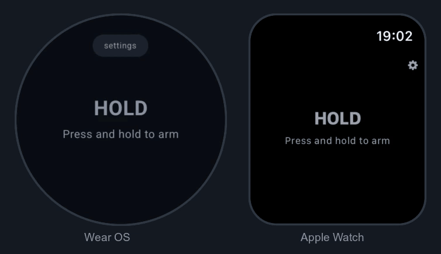

<!-- Store badges go here once the listings exist:


-->

# Halotap

A personal-safety app for the wrist. Hold the screen to arm it, walk to your car, and let go
when you get there — then enter your PIN or pattern to disarm. A wrong code, or silence past
the deadline, escalates.

A halo you keep with a tap: hold it and you are inside the ring, let go and it asks who
you are.

<p align="center">
  
</p>

> **Status: pre-1.0.** Both watches work end to end: set a PIN on the watch itself, add
> emergency contacts, and a breach alerts them. On Wear OS the alert survives the app being
> killed, because an exact alarm hands the sending to a worker. On Apple Watch a breach is
> guaranteed to be **noticed** but not necessarily **sent** — watchOS has no equivalent of
> `AlarmManager`, and that gap cannot be closed. See [Open decisions](#open-decisions) and
> [SECURITY.md](SECURITY.md).

## How it behaves

| State | What it means |
| --- | --- |
| `Idle` | Open, not held. Nothing is being watched. |
| `Armed` | Finger down. This is the walk. |
| `Challenge` | You let go. The secret is owed: two tries, ten seconds each, with a bar draining so you can see how long is left. |
| `Disarmed` | Correct code. Confirms, then returns to `Idle`, ready for the next walk. |
| `Breached` | Wrong twice, or the deadline passed. Carries the reason; escalates. |

Silence counts as a breach on purpose: if the watch is taken or dropped, nobody has to guess
wrong for the alarm to matter. A wrong first entry restarts the ten seconds, because fumbling it
is exactly what someone rattled would do.

If the watch dies while on watch, no alert is sent — nothing runs on a powered-off device.
Halotap warns below 15% battery and, on the next boot, tells you it stopped watching rather
than letting you assume it had you covered.

An interruption is not a release, and it does not end the watch either: the armed moment is
persisted, so a call that tears the app down leaves you still on watch when you return. The
marker is dropped after an hour or a reboot, so a walk that ended days ago cannot arm the app
behind your back.

An interruption is not a release. If the screen is taken — an incoming call, a wrist dropping —
the session stays armed rather than starting a challenge nobody can see. A tap releases
normally once you are back. Only a genuine lift of the finger ends the hold.

Disarming does not close the app. It could on Wear OS, but watchOS has no API for an app to
terminate itself — `WKApplication` exposes no such call and `exit()` is forbidden by the HIG —
so both platforms return to `Idle` instead. Identical behaviour is worth more than Android's
ability to finish its own task.

## Layout

```
sharedLogic/   Kotlin Multiplatform. The state machine, shared by both watches.
wearApp/       Wear OS app (Compose for Wear OS).
watchApp/      Apple Watch app (SwiftUI), generated by xcodegen from project.yml.
androidApp/    Phone companion: where Wear OS gets its contacts.
```

There is no iPhone app and no shared-UI module. Apple Watch does its own setup, and the
template's leftovers were deleted rather than left to rot.

**Why the UI is not shared.** Compose Multiplatform cannot render on watchOS. So `sharedLogic`
holds everything that matters — arming, timing, secret verification — while Wear OS uses
`androidx.wear.compose` and Apple Watch uses SwiftUI. Each watch draws; neither decides.

## Building

Requires JDK 17+, the Android SDK, and for the Apple Watch, Xcode plus
[xcodegen](https://github.com/yonaskolb/XcodeGen) (`brew install xcodegen`).

`make help` lists everything. The usual loop:

```bash
make test           # shared tests, on this host's watchOS simulator and the JVM
make wear-avd       # once: install the Wear system image, create the AVD
make wear-emulator  # boot it (blocks, so give it its own terminal)
make wear-run       # build, install, launch on the watch
make watch-build    # regenerate the Xcode project and build for the watch simulator
make test-watch     # Keychain and contacts tests on the watch simulator
make test-device    # Keystore, SMS and sync tests on a connected watch
```

Targets that depend on the host architecture — which Kotlin/Native target the tests run on,
which arch xcodebuild gets — are derived from `uname -m`, so the same commands work unchanged
on Apple Silicon.

The watch app builds `sharedLogic` itself: a pre-build script picks the Kotlin target matching
the destination, links that one slice, and stages it where `FRAMEWORK_SEARCH_PATHS` expects it.
Nothing to run by hand. Building from Xcode.app may need `JAVA_HOME` set, since Xcode does not
inherit a shell profile.

The watch targets need a simulator runtime matching Xcode's watchOS SDK. Without it every
`xcodebuild` invocation fails with "Found no destinations":

```bash
xcodebuild -downloadPlatform watchOS
```

Watch builds are signed ad-hoc rather than with signing disabled. Disabling it strips
entitlements, and with no keychain access group every settings save fails silently with
`errSecMissingEntitlement` — the app appears to finish setup and reopens unconfigured.

### On Intel Macs

The Apple Watch side works here but is on borrowed time. Kotlin/Native has deprecated the
`macos_x64` host and the `watchosX64` target, and Apple Watch simulators need a runtime matching
your Xcode. Wear OS is unaffected and always will be. CI on Apple Silicon runners is a reasonable
stopgap; see [Open decisions](#open-decisions).

## Escalation

A breach runs every configured channel through `Escalator`. The platform's own channel is
always registered and a user-supplied one is **added, never substituted** — a mistyped webhook
should cost a redundant alert, not the alarm. A channel that throws is recorded as a failure
and the rest still run.

| Platform | Built-in channel | Why |
| --- | --- | --- |
| Wear OS | SMS to every contact, no tap | `SEND_SMS` under Play's *Physical safety/emergency alerts* exception |
| Apple Watch | Calls the first contact | watchOS ships no `MessageUI`, so it **cannot** text at all |

That asymmetry is not an oversight. `MFMessageComposeViewController` is iOS-only, and even
there it needs a human to tap Send — useless at the moment someone cannot act. Dialling is the
only alarm watchOS raises without a server, and it reaches one person, which is why configuring
a bring-your-own channel matters much more on Apple Watch.

**Bring your own** (`HttpEscalationChannel`) takes either an HTTPS webhook or Twilio
credentials and reaches everyone. Unconfigured, it reports `NotConfigured`, which is treated as
a non-event rather than a failure. It is written against a small `HttpPoster` interface, so
`:sharedLogic` still has **no third-party dependencies at all** — worth something in an app
asked to carry an emergency path.

> **There is no way to configure it on Apple Watch today.** The channel is wired up and reads
> whatever the Keychain holds, but nothing writes one: typing an HTTPS URL or a Twilio token on
> a watch is not reasonable, which is why this lives on the phone — and there is no iPhone app
> to push it from. So in practice **an Apple Watch breach dials one person and that is all**,
> and that call is reported `Unconfirmed` because `openSystemURL` reports nothing back. On Wear
> OS the phone companion sets it, and it reaches everyone alongside the SMS. Closing this is the
> largest single gap between the two platforms; see [Open decisions](#open-decisions).

## Setup

There is **no default PIN**. A fresh install is unconfigured, and the watch routes to its setup
flow instead of arming — a compiled-in fallback is exactly the thing that ends up shipping.

- **On the watch**, first run asks for a PIN twice. A PIN mistyped once during setup is one the
  user cannot enter under pressure later, and the only way out of that would be clearing app
  data. The optional duress code is set here too, from Settings.
- **On the phone** (`androidApp`), choose emergency contacts and an optional alert endpoint.
  This lives on the phone because neither watch can do it: Wear OS has no contact picker and
  watchOS ships no `ContactsUI`. It uses the system picker rather than `READ_CONTACTS`, so the
  app never holds a permission over the whole address book.

**Neither code is synced.** The watch checks the PIN and the duress code, and no other device
has any use for either, so neither leaves the watch it was set on. The duress code used to
travel from the phone, which gave one field two writers with no way to order them — and the
watch always lost, because every phone push rewrote the field from the phone's copy. A duress
code set on the watch was silently deleted the next time the user added a contact. Each watch
now owns it outright, which is also what Apple Watch always did, having no phone companion at
all.

Settings are stored through `SettingsStore`. On Android every value is encrypted with
AES-GCM under a non-exportable Android Keystore key, so the PIN and contacts are ciphertext at
rest, and each value is bound to the slot it belongs in so the ciphertexts cannot be swapped
for one another. Clearing app data destroys the key and returns the app to unconfigured, which
is the right failure: better to re-run setup than to arm with a PIN nobody remembers setting.

## Open decisions

- **The sync transport has not been exercised on paired hardware.** The payload, the
  `DataMap` round trip and the watch applying it are all tested on a device; delivering it
  between a real phone and a real watch is the one link checked only by inspection.
- **Apple Watch has no setup surface for the bring-your-own channel.** The channel works and
  the Keychain can hold its configuration; nothing on the watch writes one, and there is no
  iPhone companion. Until that exists, an Apple Watch breach reaches exactly one contact, by
  dialling, with no confirmation that it connected. This matters more than it would on Wear OS,
  where SMS reaches everybody without one.
- **Apple Watch durability is partial and cannot be made equal to Wear OS.** A scheduled
  extended runtime session relaunches the app at the deadline, but only for users who make
  Halotap their default responder for that session type; a local notification covers the
  rest, and can only buzz rather than send. A breach is guaranteed to be *noticed* on Apple
  Watch, not *sent* — see [SECURITY.md](SECURITY.md).
- **No UI tests on either platform.** Every claim about what a screen shows rests on
  screenshots, and those have twice hidden real bugs here.
- **The secret is encrypted, not hashed.** Hashing would be stronger, but needs a real KDF, and
  hand-rolling one is worse than hardware-backed encryption at rest.
- **Launching fast.** A tile, complication, or long-press shortcut beats finding an icon in the
  dark.
- **Telling the contacts it is over.** The alert screen can now be stood down with the disarm
  PIN, but that only clears the watch. Nobody has told the people who were texted, and doing
  that is the same delivery problem as sending the alert in the first place.
- **Nothing buzzes on a breach while the app is on screen.** The wrist is only tapped when the
  deadline wakes a backgrounded app. If the user is looking at the keypad, the alert goes out
  in silence.
- **Changing the PIN does not ask for the old one.** Anyone holding the unlocked watch can set
  their own PIN and duress code from Settings, which defeats the duress code for the next walk.
- **The alert screen does not survive a force-quit.** Killing the app returns it to standby
  with the red screen gone, and no in-app gate can prevent that. The *delay* is no longer
  skippable with it — the wrong-code count and its doubling wait are persisted, so relaunching
  does not hand back a fresh set of attempts — but clearing the screen is cosmetic either way.
  This is why the alert record exists and why it is the part that is actually defended.

## Releasing

The version is declared once, as `appVersion` in `gradle/libs.versions.toml`. Everything else
derives from it: the Android `versionName`, both `versionCode`s, and the Apple
`MARKETING_VERSION` and `CURRENT_PROJECT_VERSION`.

```
appVersion = "v0.2.4"
  -> versionName    0.2.4      (the "v" is stripped; Apple rejects it)
  -> versionCode    2040       phone
  -> versionCode    2041       wear, +1 so Play sees two distinct APKs
  -> build number   2040       watchOS
```

Patch versions are spaced ten apart — `0.2.4` is 2040, not 204 — so the wear `+1` can never
land on the next patch's phone code. Under the old spacing it did: wear 0.2.0 and phone 0.2.1
were both 201, which Play rejects as a duplicate versionCode for one `applicationId`.

To release: bump `appVersion`, add a matching `## [0.2.4]` section to
[CHANGELOG.md](CHANGELOG.md), and push a matching tag (`v0.2.4`). The release workflow refuses a tag that disagrees with the
catalog, or one with no changelog section — both are cheap to catch before a build reaches a
store and impossible to fix afterwards.

Publishing stops at **Play internal (draft)** and **TestFlight**, never straight to production.
A safety app that auto-promoted itself on a tag push is one bad release away from leaving people
without a working alarm, so the final promotion stays a deliberate click.

Both publish steps are skipped, with a notice, when their credentials are absent — so tagging is
useful before either store listing exists. To enable them, set:

| Secret | For |
| --- | --- |
| `ANDROID_KEYSTORE_BASE64`, `ANDROID_KEYSTORE_PASSWORD`, `ANDROID_KEY_ALIAS`, `ANDROID_KEY_PASSWORD` | Signing the Android bundles |
| `PLAY_SERVICE_ACCOUNT_JSON` | Uploading to Play |
| `APPLE_CERT_P12_BASE64`, `APPLE_CERT_PASSWORD`, `APPLE_PROVISIONING_PROFILE_BASE64` | Signing the watch build |
| `APP_STORE_CONNECT_KEY_ID`, `APP_STORE_CONNECT_ISSUER_ID`, `APP_STORE_CONNECT_KEY_P8` | Uploading to App Store Connect |

The first release of each still needs its listing created by hand: Play will not accept an
upload for an app that does not exist, and App Store Connect needs the record and metadata
before a build can be attached.

## Contributing and security

[CONTRIBUTING.md](CONTRIBUTING.md) covers the build, the tests, and the handful of things
that have bitten us. [SECURITY.md](SECURITY.md) has the threat model and how to report a
vulnerability privately — please do not open a public issue for anything that defeats the
alarm. [PRIVACY.md](PRIVACY.md) describes exactly what is stored and what leaves the device
(very little, and nothing without a breach). Everyone is expected to follow the
[Code of Conduct](CODE_OF_CONDUCT.md).

## License

[Apache 2.0](LICENSE). Free and open source.
